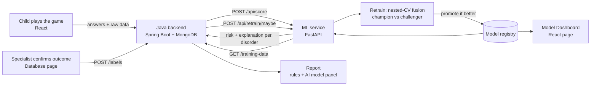

# Game Integration, Live Scoring and Retraining

This document explains how the trained models plug into the NeuroQuest game, what changed in the game, and how
models retrain themselves from collected data. For how the models were built, see
[ML_METHODOLOGY.md](ML_METHODOLOGY.md); for the numbers, see [RESULTS.md](RESULTS.md) or the **Model Dashboard**
page in the app.

## 1. The pipeline



1. The child plays the game. Each answer is sent to the backend with its timing and, for the two new tasks, the raw
   data the models need (§2).
2. On submit, the backend computes the existing rule-based report and then asks the ML service to score the session.
   The rule-based report stays the baseline, so the game always works, even when the ML service is off.
3. A model **trained on real data** can read the session. When it does, its risk level replaces the rule-based risk
   for that disorder, and an observation names the model version and probability. A model **trained on synthetic
   data** is shown in the report's *AI Model Assessment* panel but never changes the result.
4. Later, a teacher or specialist records the confirmed outcome in the session history (**Database** → *Confirmed
   outcome*). Parents can also report an existing diagnosis at registration. These are weaker labels, and a
   specialist label always overrides them.
5. Each new label triggers `POST /api/retrain/maybe`. When 20 new labels have arrived for a disorder, the ML service
   retrains from the backend's labelled sessions (§4). It promotes the new model only if it beats the live one.
6. The **Model Dashboard** page reads the ML service live. It shows every experiment, the model each disorder uses
   now, the full version history and each retraining decision.

## 2. What changed in the game (kept small)

| Change | Why | Files |
|---|---|---|
| **New Q16: Copy the sentence** (dysgraphia). The child writes "The cat sat on the mat." on a white canvas, which is sent as a PNG. | The dysgraphia model needs a handwriting image. | `frontend/src/components/games/CopySentenceGame.jsx`, `QuestionBankService.java` |
| **New Q17: Number-sense round** (dyscalculia). Short repeated trials of the same five skills as Q11–Q15: 10 subitizing, 16 magnitude, 10 number line, 6 sequence and 10 addition trials, about 3 minutes in total. | The dyscalculia model needs several trials per skill, logged per trial. | `frontend/src/components/games/NumberSenseRound.jsx`, `QuestionBankService.java` |
| **Real stroke jitter** in the letter-trace game. The score was hard-coded to 12 or 25 before. | Motor features must be measured. | `CanvasLetterTraceGame.jsx` |
| `rawData` on each answer | Carries the image or trial log to the backend. | `AssessmentEngine.jsx`, `QuestionResponse.java` |
| Optional **existing diagnosis** at registration | Weak training labels. | `RegistrationView.jsx`, `AssessmentController.register` |
| **Confirmed outcome** buttons per session | Strong (specialist) training labels. | `OutcomeLabels.jsx` in `HistoryModal.jsx`, `POST /api/assessments/{id}/labels` |
| **AI Model Assessment** panel in the report | Shows each model's probability, risk and what drove it. | `ModelAssessmentPanel.jsx` |
| **Model Dashboard** page (top-bar button, or `/#dashboard`) | Shows the results and live model status. | `ModelDashboard.jsx`, `RetrainingPanel.jsx` |

Questions Q1–Q15 are unchanged.

## 3. Which model reads what

| Disorder | Model at launch | Reads | Effect on the report |
|---|---|---|---|
| Dyslexia | **None, rules only.** The research model needs the 32-question Dyt test, which the game doesn't have. | — | Rules |
| Dysgraphia | Research model: early fusion of handwriting geometry and CNN features (ROC-AUC 0.933 on 249 scans) | The Q16 image | **Sets the dysgraphia risk** (trained on real data) |
| Dyscalculia | Synthetic-trained early-fusion logistic regression | The Q17 trials | Shown only (trained on synthetic data) |

After retraining, each disorder can switch to a **game-native model**. These models train on the game's own
answers, response times and motor data, plus Q16 geometry and Q17 round features when present. They are fitted
on labelled game sessions with the same fusion families, and use the following modalities:

* **Dyslexia:** answers, response time, profile (age, letter reversal)
* **Dysgraphia:** answers, response time, motor control, handwriting geometry
* **Dyscalculia:** answers, response time, profile, number-sense round

**Caveat for dysgraphia.** The research model learned from *scanned paper*, and Q16 is *finger or mouse on a
screen*. Its accuracy on screen handwriting is unknown until game sessions are labelled. Retraining tests this
directly: the live model is scored on labelled game sessions it never saw, and it is replaced if a game-native
model does better.

## 4. Retraining rules (champion / challenger)

Implemented in `ml/service/retrain.py`. All values are constants at the top of the file.

| Rule | Value |
|---|---|
| Start training a disorder | ≥ 40 labelled sessions, ≥ 10 in each class |
| Re-check after | every 20 new labels for that disorder (`RETRAIN_EVERY`) |
| Evaluation | nested CV on game sessions: 5 outer folds × 3 repeats, 3 inner folds |
| Which challenger | the simplest model within 0.005 ROC-AUC of the best (same rule as the research models) |
| Champion's score | ROC-AUC on labelled sessions it was **not** trained on. A game model with too few new sessions falls back to its own CV score. |
| Promote when | challenger ≥ champion + 0.01, **and** challenger ≥ 0.65 |
| Labels | specialist labels win. Parent labels are used only when no specialist label exists, and each version records its label sources. |

Every version is kept in `ml/models/registry.json`, and every run in `ml/models/retrain_history.json`. Rolling
back means setting `active` to an earlier version id.

## 5. APIs

**ML service** (`ml/service/app.py`, port 8000)

| Method | Path | Purpose |
|---|---|---|
| GET | `/api/dashboard` | Every table and figure list the Model Dashboard draws |
| GET | `/api/figures/{experiment}/{name}` | Result figures (SHAP, occlusion maps, ROC, …) |
| POST | `/api/score` | Body: a session as stored by the backend. Returns per-disorder `status`, `probability`, `risk_level`, `model_version`, `modality_contributions_logodds`. |
| POST | `/api/retrain` | Retrain now. Uses `{"sessions": [...]}` from the body, or fetches `/api/assessments/training-data` from the backend. |
| POST | `/api/retrain/maybe` | Retrain only if `RETRAIN_EVERY` new labels have arrived |
| GET | `/api/models` | Registry, history and policy |

**Backend additions** (`AssessmentController`)

| Method | Path | Purpose |
|---|---|---|
| POST | `/api/assessments/{id}/labels` | `{"disorder": "DYSLEXIA", "value": 0 or 1, "source": "specialist" or "parent"}` |
| GET | `/api/assessments/training-data` | Completed sessions with at least one label |

The backend reads the ML service address from `ml.service.url` in `application.properties`. Every ML call fails
soft: if the service is down, the session still completes with the rule-based report.

## 6. Running everything

```bash
# 1. MongoDB on localhost:27017, then the backend (Java 21 + Maven)
cd backend && mvn spring-boot:run

# 2. ML service (from the project root)
pip install -r ml/requirements.txt
python -m uvicorn app:app --app-dir ml/service --port 8000

# 3. Game
cd frontend && npm install && npm run dev      # then open the printed URL; Model Dashboard is in the top bar
```

**Test the loop without real children.** `python ml/service/selftest.py <empty folder>` generates 160 **simulated**
sessions, including real dataset images for Q16 and simulated trials for Q17. It scores them, retrains twice and
prints each decision. Everything is written to the folder you pass, never to the real registry.

## 7. Limits and next steps

* **Privacy.** Handwriting images and labels are children's health-related data. Before real use: get consent, add
  authentication on `/labels` and `/training-data` (both are open in this capstone build), and agree a retention policy.
* **Dyslexia** stays rule-based until about 40 labelled game sessions exist.
* The **synthetic dyscalculia** model is a placeholder. It never changes a report, and the first game-native model
  that passes the bar replaces it.
* **Label quality** sets the ceiling. Encourage specialist confirmation over parent reports.
