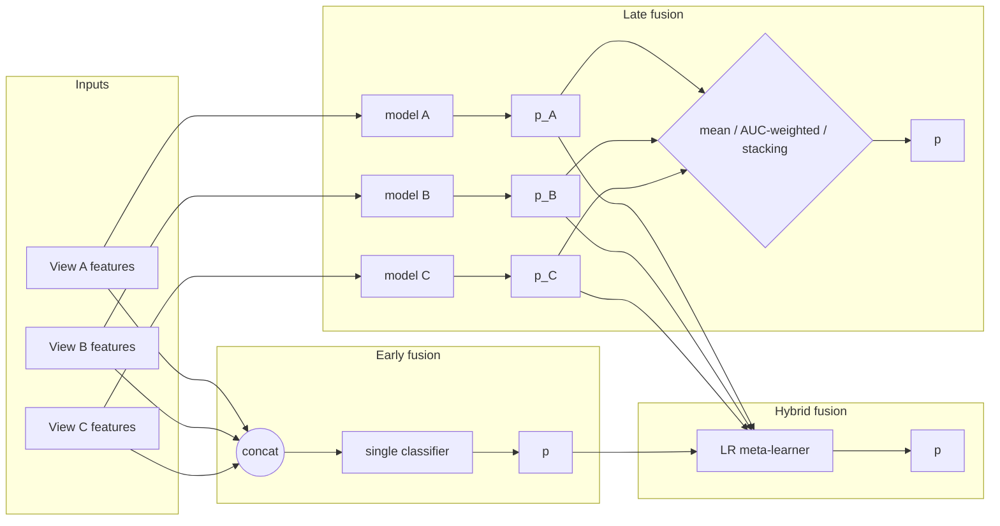
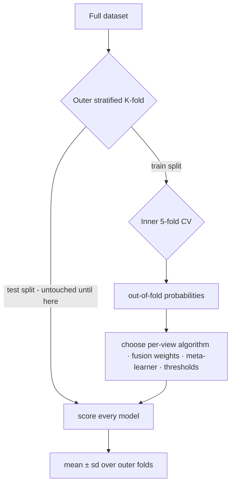

# ML Methodology - Multimodal Fusion & Explainable AI for Learning-Disability Screening

This document explains **what** we trained, **why** we made each design decision and **how** to reproduce
it. The numbers are in [RESULTS.md](RESULTS.md), which is generated automatically from the saved metrics.

> **Scope note.** These models are **screening aids**. They flag children who may benefit from a professional
> assessment; they do not diagnose dyslexia, dysgraphia or dyscalculia.

---

## 1. Overview

The screening game covers three learning disorders: **dyslexia**, **dysgraphia** and **dyscalculia**
(see `backend/.../model/DisorderDomain.java`). Today the backend scores the game with hand-written rules
(`AssessmentScoringService.java`). The goal of the ML work is to replace or support those rules with
models learned from labelled data, which should be:

1. **Multimodal.** Each disorder is observed through several kinds of signal, and we combine them with
   **early fusion**, **late fusion** and a **hybrid** of the two.
2. **Accurate.** Results are measured honestly, with nested cross-validation and metrics that suit
   imbalanced classes.
3. **Explainable.** Every prediction can be traced back to the modalities, features, game questions or image
   regions that drove it.

| Disorder | Dataset in `datasets/` | Modalities used | Status |
|---|---|---|---|
| Dyslexia | `Dyt-desktop.csv` + `Dyt-tablet.csv`: 5,039 children, 32 gamified questions | Demographics · Task accuracy · Interaction behaviour | Trained |
| Dysgraphia | `DATASET DYSGRAPHIA HANDWRITING/`: 249 handwriting images | Handwriting geometry · Deep visual (CNN) | Trained |
| Dyscalculia | `dyscalculia_castaldi2024/` (real, 37 children) + `dyscalculia_synthetic/` (simulated game telemetry, 3,000 children) | Time perception · Cognitive profile (real); Demographics · Task accuracy · Response time · Number-sense profile (synthetic) | Trained. Synthetic results test the pipeline only (see §8). |

Code lives in [`ml/`](../ml):

```
ml/
├── requirements.txt
├── src/
│   ├── common.py               paths, seeds, metrics, threshold tuning, plot style
│   ├── fusion.py               generic early / late / hybrid fusion framework + nested CV
│   ├── reporting.py            standard result tables & figures
│   ├── viz.py                  plotting helpers
│   ├── dyslexia_pipeline.py    dyslexia data cleaning, views, models, SHAP
│   ├── dysgraphia_features.py  image preprocessing, geometry features, CNN embeddings
│   ├── dysgraphia_pipeline.py  dysgraphia models, SHAP, permutation importance, occlusion maps
│   ├── dyscalculia_synthetic.py  simulated game telemetry for Q11-Q15 (SYNTHETIC)
│   ├── dyscalculia_features.py   trial-level game logs -> per-child features (synthetic or real)
│   ├── dyscalculia_pipeline.py   real (Castaldi 2024) + synthetic dyscalculia experiments
│   ├── main_model.py           ScreeningSystem: one call -> risk level per disorder + overall
│   ├── export_dashboard.py     flattens results into CSVs for the accuracy dashboard
│   └── make_report.py          writes docs/RESULTS.md from ml/results/
├── results/<task>/             metrics CSV/JSON + all figures
└── models/<task>_fusion.joblib final models trained on all data
```

---

## 2. Data and preprocessing

### 2.1 Dyslexia: gamified test interaction data

There are 3,644 desktop and 1,395 tablet participants, aged 7-17. For each of 32 game questions the dataset
records `Clicks`, `Hits`, `Misses`, `Score`, `Accuracy` and `Missrate`, plus gender, native-language flags
and age. Label: `Dyslexia` (Yes/No). It is **imbalanced**: about 10.7% positive.

Cleaning decisions:

| Issue found | Evidence | Fix |
|---|---|---|
| Corrupted ratio columns: decimal points were lost (`0.875` → `875`) | 2,521 `Accuracy` and 2,569 `Missrate` cells > 1 | Recompute `Accuracy = Hits/Clicks` and `Missrate = Misses/Clicks`. These identities hold for about 99% of clean cells. |
| Question 29 was never shown on the tablet | 100% missing in `Dyt-tablet.csv` | Drop Q29 from both devices |
| Other questions partly missing on the tablet (Q13, Q18-28, Q30-32) | ~45k NaNs | Median imputation **plus missing-indicator columns** (fitted inside each training fold). XGBoost handles NaN natively. |
| Two devices | separate CSVs | Merge and add a `Device_tablet` flag |

The **modalities (views)** are defined by *what kind of signal* a column measures:

| View | Columns | Meaning |
|---|---|---|
| Demographics | Gender, Nativelang, Otherlang, Age, Device_tablet | Who the child is |
| Task accuracy | `Hits`, `Score`, `Accuracy` × 31 questions | *What* the child got right |
| Interaction behaviour | `Clicks`, `Misses`, `Missrate` × 31 questions | *How* the child interacted (impulsive clicking, error patterns) |

### 2.2 Dysgraphia: handwriting images

The dataset has 114 *Potential Dysgraphia* (positive) and 135 *Low Potential Dysgraphia* images. Each is a
binarised scan of a child copying a short Malay sentence, often on ruled lines.

Preprocessing (`dysgraphia_features.preprocess`):

1. Make the ink white-on-black and binarise with Otsu's method.
2. **Remove ruled lines.** A morphological opening with a long horizontal kernel detects the lines, which are
   subtracted. A vertical closing sized to the measured line thickness then reconnects strokes that crossed
   the line. Lines are paper, not handwriting, so leaving them in would let a model learn paper type.
3. Remove specks and crop to the ink.
4. **Scale normalisation (important).** Raw letter height *in pixels* alone separates the two classes with
   ROC-AUC ≈ 0.90. The scans' resolution (DPI) is unknown and not consistent, so a model could learn
   *scanner resolution* instead of handwriting. We therefore rescale every image so that the median letter
   height is 40 px **before** extracting either modality. The cost: a real "letters are too big"
   (macrographia) signal may be lost. We chose the conservative option; see §7.

The two **modalities**:

| View | Dim. | What it captures |
|---|---|---|
| Handwriting geometry | 25 | Interpretable markers linked to clinical dysgraphia rating scales: letter-size variability (`letter_height_cv`, `letter_area_cv`), baseline and top-line drift (`baseline_residual`, …), spacing irregularity (`gap_cv`, `gap_max`, `word_gap_count`), slant mean/variability, stroke width and its variability, contour tremor/convexity, fragmentation (broken strokes), ink density. All lengths are expressed in units of the writer's own letter height. |
| Deep visual (EfficientNet-B0) | 1,280 | ImageNet-pretrained EfficientNet-B0 embeddings. The handwriting strip is cut into overlapping 224×224 tiles (stride 112), each tile is embedded and the embeddings are averaged. Inside each model the embedding is standardised and reduced with PCA (32 components, fitted on training folds only). |

---

## 3. Fusion strategies

All strategies are implemented once in [`ml/src/fusion.py`](../ml/src/fusion.py) (`MultimodalFusion`) and
reused for every disorder.



| Family | Variant | How it works |
|---|---|---|
| **Unimodal** (baseline) | one per view × algorithm | Uses only one modality, so we can measure what fusion adds |
| **Early fusion** (feature-level) | LogReg, Random Forest, XGBoost, MLP/SVM | Concatenate all views' features into one vector, then train one classifier. It can learn interactions *between* modalities. |
| **Late fusion** (decision-level) | Soft voting | Mean of the per-view probabilities |
| | AUC-weighted voting | Weighted mean; each view's weight ∝ its inner-CV AUC − 0.5 |
| | Stacking | Logistic-regression meta-learner on the per-view log-odds, trained on **out-of-fold** probabilities |
| **Hybrid fusion** | views + early | Meta-learner over the per-view probabilities **and** the best early-fusion probability |

For late fusion, the algorithm used for each view is chosen automatically: it is the one with the best inner-CV
AUC for that view. Late fusion tolerates a missing modality, which matters in the game (e.g. a child
skips the handwriting task). Early fusion usually reaches higher accuracy when every modality is present.

**Class imbalance** is handled with `class_weight="balanced"` / `scale_pos_weight` and by **tuning the
decision threshold**. For each model, the threshold is set to the value that maximises balanced accuracy
(Youden's J) on training-side out-of-fold predictions.

---

## 4. Evaluation protocol



* **Nested cross-validation.** Every label-dependent choice (per-view algorithm, fusion weights,
  meta-learner, decision threshold, PCA, imputation, scaling) is fitted inside the outer training split.
  Outer test folds are only used for scoring. Dyslexia uses 5 outer folds. Dysgraphia uses 5 outer folds
  × 3 repeats, because 249 images give noisy single splits.
* **Metrics.** For dyslexia, **accuracy is misleading**: always predicting "no dyslexia" already scores
  89.3%. We therefore rank models by **ROC-AUC** and report **balanced accuracy**, **sensitivity** (share of
  at-risk children caught), **specificity**, precision, F1, MCC and PR-AUC. Results are mean ± sd over
  outer folds, plus a bootstrap 95% CI where each sample is predicted exactly once.
* **Final models.** After evaluation, every model is refitted on all data and saved to `ml/models/`. These
  refitted models are used for deployment and for the global explanations.

---

## 5. Explainable AI

| Question | Technique | Output |
|---|---|---|
| Which **modality** matters most? | Dyslexia: share of total \|SHAP\| per view (early-fusion XGBoost). Dysgraphia: **grouped permutation importance**, which shuffles all columns of one view together and measures the drop in held-out AUC. | `xai_modality_importance.png` |
| How does late fusion trust each modality? | AUC-weighted voting weights and stacking coefficients, mean ± sd over folds | `fusion_weights.png` |
| Which **features** matter, and in which direction? | **SHAP**: TreeExplainer for XGBoost, permutation explainer for the geometry model | `xai_shap_beeswarm.png`, `xai_shap_geometry_beeswarm.png` |
| Which **game questions** are most diagnostic? | SHAP summed over each question's 5-6 features | `xai_question_importance.png`. Use this to decide which mini-games to keep, extend or drop. |
| Why was **this child** flagged? | SHAP waterfall (feature level) + late-fusion log-odds contribution per modality | `xai_shap_local_example.png`, `xai_late_fusion_local_example.png`, `xai_late_fusion_contributions.csv` |
| **Where** in the handwriting does the CNN look? | **Occlusion sensitivity.** Grey out 56×56 patches, re-embed only the affected tiles, and record the change in p(dysgraphia). Computed on images *held out* from the explained model. | `xai_occlusion_maps.png` |

Read the explanations as **associations the model learned**, not as causes. For example, a high SHAP value
for `Missrate` on a question means "children with dyslexia in this dataset tended to make more wrong clicks
there". It does not mean that wrong clicks cause dyslexia.

---

## 6. Results

See **[RESULTS.md](RESULTS.md)**, which includes full tables, ROC curves, confusion matrices and all XAI figures.

---

## 7. Limitations and threats to validity

* **No subject has data for more than one disorder.** The dyslexia and dysgraphia datasets come from
  different children, so we fuse modalities *within* each disorder; we cannot fuse *across* disorders. A
  true cross-disorder model (one child → three risk scores from one game session) needs paired data
  collected by our own game (§8).
* **Dysgraphia sample size.** With 249 images, even with repeated nested CV, fold-to-fold variance is large;
  see the ± values.
* **Scale normalisation trade-off.** We deliberately removed absolute letter size (§2.2). If future scans
  are taken at a *known, fixed* DPI, add `letter_height_mm` back as a feature; it is likely a genuine signal.
* **Different sentences.** The dysgraphia images do not all show the same sentence, so features like
  `sentence_length_in_letter_heights` partly reflect *which* sentence was copied. If the sentence correlates
  with the label in the original data collection, this is a confound.
* **Possible acquisition differences between the dysgraphia classes.** The occlusion maps and SHAP show
  that the models rely heavily on stroke thickness *relative to* letter size, and on spacing regularity.
  Many low-potential samples are written with a visibly thicker pen at a smaller letter size. Some patterns
  run against clinical intuition: *more regular* gaps (`gap_cv` ↓) push towards dysgraphia. Part of the
  0.93 AUC may therefore come from how and with what pen each group was recorded, not from the handwriting
  itself. Ask the dataset authors how samples were collected, and validate on our own game's canvas data.
* **Occlusion maps saturate** on very confident predictions (p ≈ 1.00): hiding one patch barely changes the
  output, so those maps look blank. Computing the maps on log-odds instead of probabilities would fix this.
* **Domain shift.** Both datasets were collected outside our game: the dyslexia data comes from a
  Spanish-language gamified test, and the dysgraphia data from Malay handwriting. The models must be
  re-validated on data from our game before their outputs are shown to parents or teachers.
* **Labels.** "Potential / low-potential dysgraphia" and the dyslexia labels are screening-level labels, not
  necessarily formal clinical diagnoses.

---

## 8. Dyscalculia and next steps

<a id="dyscalculia"></a>
**Dyscalculia.** We searched for public labelled data. The best-matching study (Lamb, Krieger & Kuhn 2024:
480 children; subitizing, magnitude comparison and number-line tasks) has no public data; its authors can be
asked (tobias.kuhn@tu-dortmund.de). We use two sources instead:

1. **Real: Castaldi et al. 2024** (Zenodo 10966052, CC BY 4.0). It covers 37 children (15 with
   dyscalculia) and measures time perception (PSE and Weber fraction at 500 ms and 1,500 ms) plus age, IQ and
   gender. `math` is the diagnostic criterion, so we drop it because it would leak the label. We also drop
   `reading`: it is 46% missing, and its values and its missingness both separate the groups. The protocol
   is 5-fold × 10-repeat nested CV. With n = 37 the estimate is very uncertain.
2. **Synthetic game telemetry** (`ml/src/dyscalculia_synthetic.py`). This simulates 3,000 children playing
   extended versions of the game's Q11-Q15 tasks: 10 subitizing, 16 magnitude-comparison, 10 number-line
   (0-20), 6 sequence and 10 arithmetic trials. Each child has latent abilities (ANS acuity, symbolic and
   arithmetic skill, speed, attention, subitizing). Children with dyscalculia are shifted on these by
   assumptions informed by the literature: an arithmetic deficit of -1.4 SD, an ANS deficit of -1.0 SD,
   and largely intact subitizing (Decarli et al. 2020). The simulation adds development with age (ANS
   sharpening, the shift from a logarithmic to a linear number line), children with attention difficulties
   who perform poorly without having dyscalculia, and 5% label noise. Features are computed from trial logs
   by `dyscalculia_features.py`, the same code that will process real game exports. Uses of this data:
   * testing the pipeline end-to-end;
   * **checking the XAI against known ground truth**: explanations should rank the planted
     arithmetic/number-sense effects first and subitizing last;
   * deciding how many trials per task the game needs.

   Its accuracy is never a real-world result.

**Game change this implies.** The game asks one item per dyscalculia task. Stable measures (Weber fraction,
number-line linearity, RT variability) need several trials per task. Extend Q11-Q15 to about 6-16 trials
each and export trial-level logs in the format documented in `dyscalculia_features.py`.

**Main screening model.** `ml/src/main_model.py` (`ScreeningSystem`) loads the best model per disorder. For
each disorder it returns a probability, a backend risk level and per-modality log-odds contributions:
* MODERATE_TENDENCY starts at the threshold that maximises balanced accuracy;
* HIGH_RISK starts where 95% of true negatives score lower.

It then combines the disorders like `AssessmentScoringService.synthesizeOverall`, and any disorder may be
missing. The dyscalculia slot currently uses the synthetic-trained model and is flagged
`synthetic_training_data: true`. Swap it for a model trained on real game data before production use.

**Integration with the game.** The saved `ml/models/*.joblib` files can be served from a small Python
(FastAPI) microservice. `AssessmentScoringService` would call it and fall back to the current rules if the
service is unavailable. The explanation outputs (top features/questions, per-modality contributions) map
directly onto the report's `clinicalObservations`.

---

## 9. Reproducing

```bash
pip install -r ml/requirements.txt
python ml/src/dyslexia_pipeline.py      # ~10-15 min on CPU
python ml/src/dysgraphia_pipeline.py    # first run downloads EfficientNet-B0 weights (~16 MB) and caches features
python ml/src/dyscalculia_synthetic.py  # generates datasets/dyscalculia_synthetic/ (simulated)
python ml/src/dyscalculia_pipeline.py   # real (Castaldi 2024) + synthetic dyscalculia
python ml/src/main_model.py             # builds the ScreeningSystem card + smoke test
python ml/src/export_dashboard.py       # CSVs for the accuracy dashboard
python ml/src/make_report.py            # regenerates docs/RESULTS.md
```

All randomness is seeded (`SEED = 42` in `common.py`). Feature extraction is cached in `ml/.cache/` (git-ignored).
