# Results - Multimodal Fusion & Explainable AI

_Auto-generated by `ml/src/make_report.py` on 2026-11-13 from `ml/results/`. Do not edit by hand - re-run the pipelines and this script instead._

All numbers are **held-out** (outer-fold test) estimates from nested cross-validation; every model choice, fusion weight, meta-learner and decision threshold was fitted on the training side of each outer fold only. See [ML_METHODOLOGY.md](ML_METHODOLOGY.md) for the method.

## 1. Dyslexia (game-interaction data)

**Data:** 5039 samples, 540 positive (10.7%). Majority-class accuracy baseline = 0.893.  
**Modalities:** Demographics (5 features), Task accuracy (93 features), Interaction behaviour (93 features)  
**Protocol:** nested CV - 5 outer folds x 5 inner folds, stratified.

### Headline

* **Best model:** `Hybrid fusion | views + early (LR meta-learner)`, ROC-AUC **0.863 ± 0.020**, balanced accuracy **0.769 ± 0.019**, sensitivity 0.781, specificity 0.757.
* **Best single modality:** `Unimodal | Interaction behaviour | XGBoost`, ROC-AUC 0.804 ± 0.039, balanced accuracy 0.734 ± 0.031.
* **Gain from fusion:** +0.059 ROC-AUC over the best single modality.
* Pooled out-of-fold ROC-AUC 95% bootstrap CI: [0.847, 0.876].
* Pooled confusion matrix of the best model: TP=422, FN=118, TN=3407, FP=1092.
* Best model by device: desktop: n=3644, AUC 0.883, balanced acc. 0.789; tablet: n=1395, AUC 0.797, balanced acc. 0.719.

### All models (mean ± sd over outer test folds)

| Family | Model | ROC-AUC | Balanced acc. | Sensitivity | Specificity | F1 | Accuracy |
|---|---|---|---|---|---|---|---|
| Hybrid fusion | views + early (LR meta-learner) | 0.863 ± 0.020 | 0.769 ± 0.019 | 0.781 ± 0.042 | 0.757 ± 0.053 | 0.414 ± 0.038 | 0.760 ± 0.044 |
| Early fusion | XGBoost | 0.862 ± 0.023 | 0.778 ± 0.027 | 0.811 ± 0.030 | 0.745 ± 0.033 | 0.414 ± 0.036 | 0.752 ± 0.031 |
| Early fusion | Logistic Regression | 0.848 ± 0.031 | 0.770 ± 0.036 | 0.785 ± 0.107 | 0.756 ± 0.060 | 0.413 ± 0.035 | 0.759 ± 0.045 |
| Late fusion | soft voting | 0.846 ± 0.026 | 0.761 ± 0.022 | 0.800 ± 0.057 | 0.721 ± 0.065 | 0.393 ± 0.041 | 0.730 ± 0.054 |
| Early fusion | Random Forest | 0.846 ± 0.024 | 0.765 ± 0.023 | 0.750 ± 0.045 | 0.780 ± 0.040 | 0.421 ± 0.035 | 0.777 ± 0.034 |
| Late fusion | stacking (LR meta-learner) | 0.846 ± 0.027 | 0.765 ± 0.021 | 0.793 ± 0.037 | 0.737 ± 0.050 | 0.401 ± 0.036 | 0.743 ± 0.043 |
| Early fusion | MLP | 0.843 ± 0.023 | 0.754 ± 0.012 | 0.787 ± 0.047 | 0.720 ± 0.041 | 0.383 ± 0.018 | 0.727 ± 0.032 |
| Late fusion | AUC-weighted voting | 0.840 ± 0.030 | 0.763 ± 0.021 | 0.752 ± 0.057 | 0.774 ± 0.036 | 0.415 ± 0.028 | 0.772 ± 0.028 |
| Unimodal | Interaction behaviour · XGBoost | 0.804 ± 0.039 | 0.734 ± 0.031 | 0.754 ± 0.055 | 0.714 ± 0.035 | 0.366 ± 0.033 | 0.718 ± 0.031 |
| Unimodal | Task accuracy · XGBoost | 0.797 ± 0.032 | 0.728 ± 0.033 | 0.726 ± 0.085 | 0.731 ± 0.038 | 0.366 ± 0.029 | 0.730 ± 0.029 |
| Unimodal | Task accuracy · Logistic Regression | 0.782 ± 0.039 | 0.704 ± 0.030 | 0.715 ± 0.101 | 0.693 ± 0.080 | 0.338 ± 0.030 | 0.696 ± 0.063 |
| Unimodal | Interaction behaviour · Logistic Regression | 0.763 ± 0.044 | 0.703 ± 0.038 | 0.713 ± 0.078 | 0.692 ± 0.039 | 0.334 ± 0.032 | 0.695 ± 0.033 |
| Unimodal | Demographics · XGBoost | 0.723 ± 0.029 | 0.671 ± 0.025 | 0.620 ± 0.094 | 0.721 ± 0.059 | 0.315 ± 0.020 | 0.710 ± 0.044 |
| Unimodal | Demographics · Logistic Regression | 0.690 ± 0.025 | 0.667 ± 0.020 | 0.631 ± 0.043 | 0.703 ± 0.015 | 0.308 ± 0.017 | 0.696 ± 0.012 |

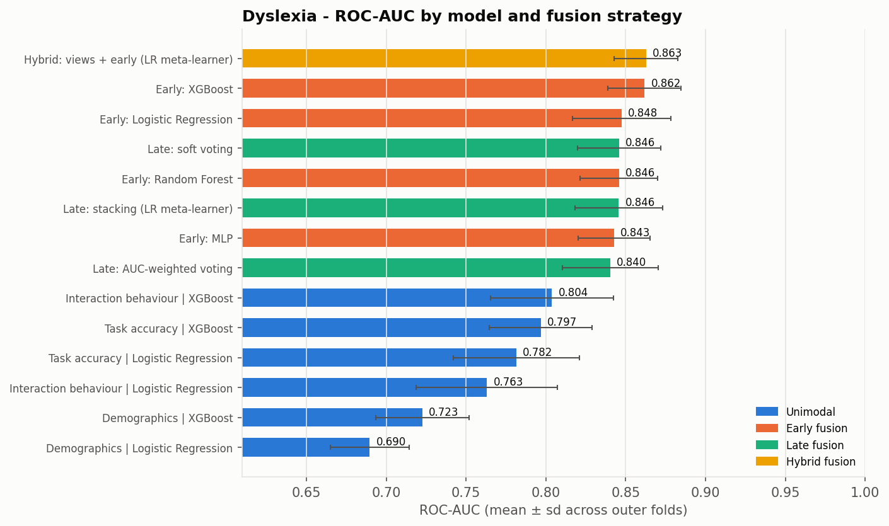

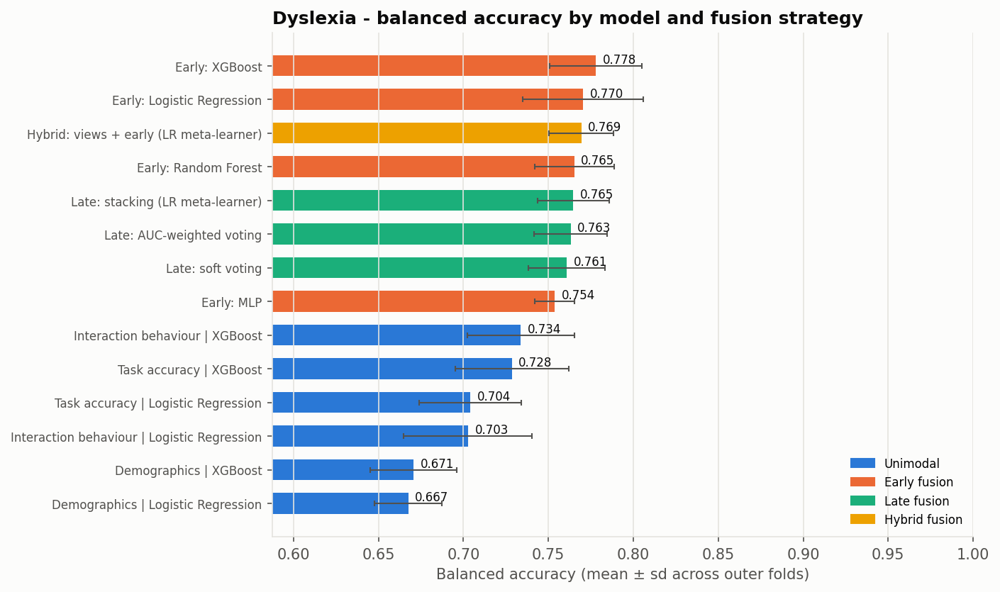

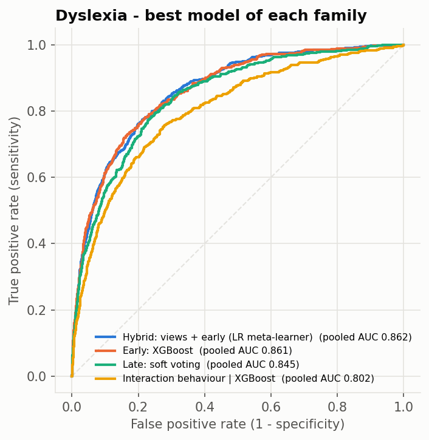
 
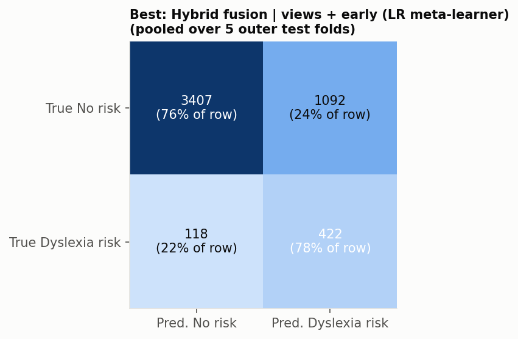

### How late fusion weighted the modalities

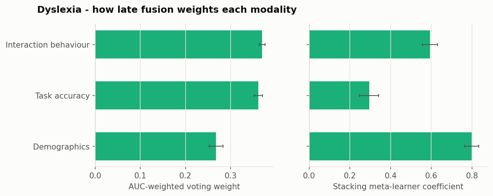

### Explainability

**Which modality matters?** Share of total mean |SHAP| of the early-fusion XGBoost:

| Modality | Share |
|---|---|
| Interaction behaviour | 42.6% |
| Task accuracy | 35.3% |
| Demographics | 22.1% |

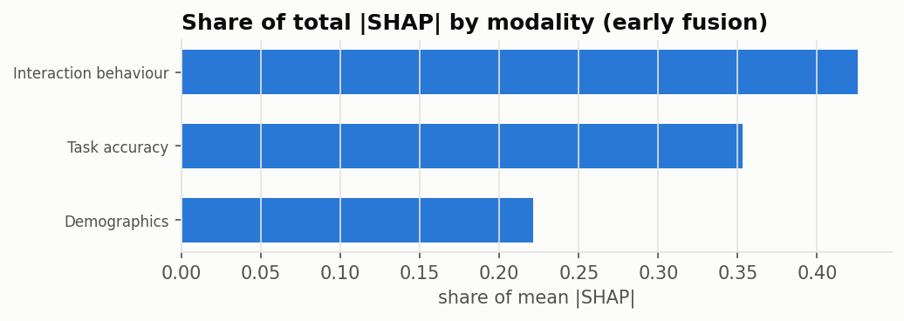

**Top features (mean |SHAP|):** `Nativelang`, `Age`, `Clicks28`, `Clicks24`, `Clicks25`, `Hits24`, `Hits22`, `Hits28`, `Clicks27`, `Hits4`

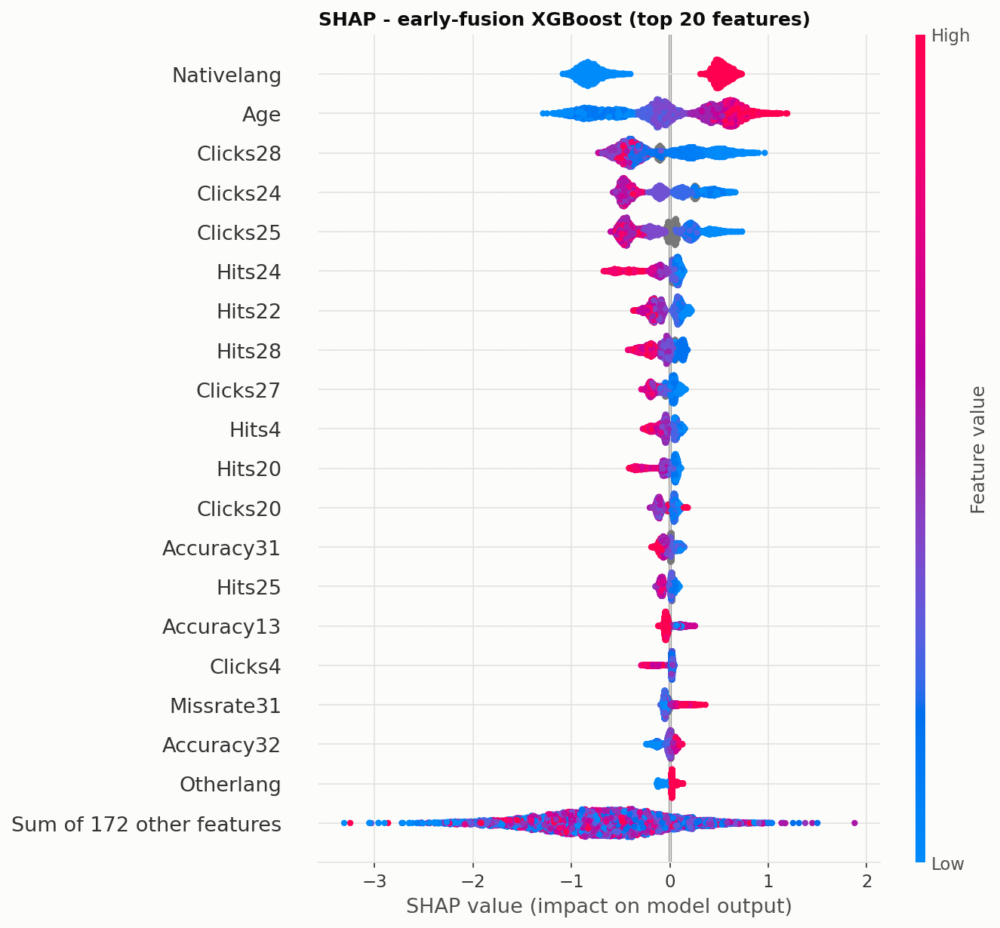

**Most diagnostic game questions** (sum of |SHAP| over each question's features): Q24, Q28, Q25, Q20, Q22, Q04, Q27, Q31, Q07, Q23

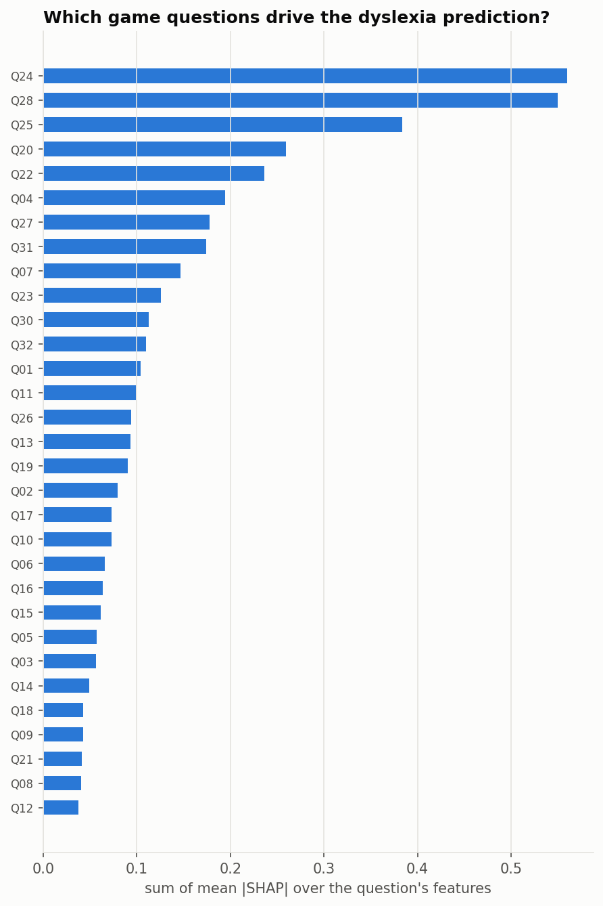

**Local explanation of one child** - feature-level (SHAP waterfall) and modality-level (late-fusion log-odds contributions):

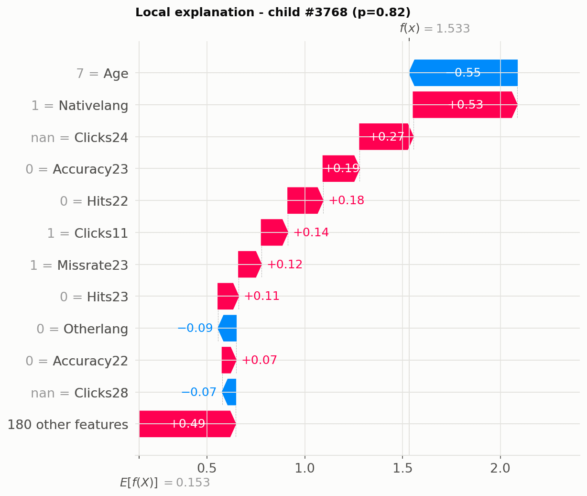
 
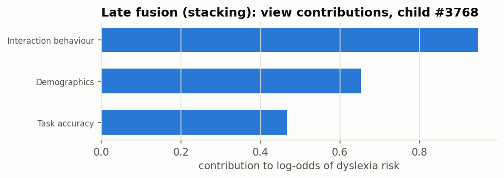

## 2. Dysgraphia (handwriting images)

**Data:** 249 samples, 114 positive (45.8%). Majority-class accuracy baseline = 0.542.  
**Modalities:** Handwriting geometry (25 features), Deep visual (EfficientNet-B0) (1280 features)  
**Protocol:** nested CV - 5 outer folds x 3 repeats (15 test folds) x 5 inner folds, stratified.

### Headline

* **Best model:** `Early fusion | Logistic Regression`, ROC-AUC **0.933 ± 0.034**, balanced accuracy **0.850 ± 0.043**, sensitivity 0.863, specificity 0.837.
* **Best single modality:** `Unimodal | Deep visual (EfficientNet-B0) | Logistic Regression`, ROC-AUC 0.920 ± 0.042, balanced accuracy 0.831 ± 0.057.
* **Gain from fusion:** +0.013 ROC-AUC over the best single modality.
* Pooled confusion matrix of the best model: TP=295, FN=47, TN=339, FP=66.

### All models (mean ± sd over outer test folds)

| Family | Model | ROC-AUC | Balanced acc. | Sensitivity | Specificity | F1 | Accuracy |
|---|---|---|---|---|---|---|---|
| Early fusion | Logistic Regression | 0.933 ± 0.034 | 0.850 ± 0.043 | 0.863 ± 0.080 | 0.837 ± 0.078 | 0.839 ± 0.046 | 0.849 ± 0.043 |
| Early fusion | XGBoost | 0.924 ± 0.034 | 0.848 ± 0.037 | 0.810 ± 0.073 | 0.886 ± 0.057 | 0.832 ± 0.044 | 0.851 ± 0.036 |
| Late fusion | AUC-weighted voting | 0.923 ± 0.041 | 0.847 ± 0.060 | 0.827 ± 0.138 | 0.867 ± 0.061 | 0.828 ± 0.083 | 0.849 ± 0.055 |
| Hybrid fusion | views + early (LR meta-learner) | 0.923 ± 0.041 | 0.840 ± 0.068 | 0.818 ± 0.149 | 0.862 ± 0.081 | 0.819 ± 0.098 | 0.842 ± 0.063 |
| Late fusion | soft voting | 0.923 ± 0.042 | 0.844 ± 0.063 | 0.830 ± 0.135 | 0.859 ± 0.055 | 0.826 ± 0.084 | 0.846 ± 0.057 |
| Late fusion | stacking (LR meta-learner) | 0.922 ± 0.039 | 0.839 ± 0.067 | 0.809 ± 0.134 | 0.869 ± 0.068 | 0.819 ± 0.092 | 0.842 ± 0.062 |
| Unimodal | Deep visual (EfficientNet-B0) · Logistic Regression | 0.920 ± 0.042 | 0.831 ± 0.057 | 0.809 ± 0.138 | 0.852 ± 0.077 | 0.811 ± 0.077 | 0.833 ± 0.052 |
| Unimodal | Handwriting geometry · SVM (RBF) | 0.913 ± 0.032 | 0.841 ± 0.043 | 0.783 ± 0.093 | 0.899 ± 0.060 | 0.821 ± 0.054 | 0.846 ± 0.040 |
| Unimodal | Handwriting geometry · Random Forest | 0.906 ± 0.038 | 0.834 ± 0.050 | 0.786 ± 0.101 | 0.881 ± 0.072 | 0.814 ± 0.059 | 0.838 ± 0.048 |
| Unimodal | Handwriting geometry · Logistic Regression | 0.905 ± 0.038 | 0.824 ± 0.046 | 0.774 ± 0.079 | 0.874 ± 0.050 | 0.804 ± 0.055 | 0.829 ± 0.044 |
| Early fusion | Random Forest | 0.905 ± 0.047 | 0.849 ± 0.041 | 0.807 ± 0.081 | 0.891 ± 0.057 | 0.833 ± 0.049 | 0.853 ± 0.040 |
| Early fusion | SVM (RBF) | 0.897 ± 0.050 | 0.830 ± 0.043 | 0.772 ± 0.087 | 0.889 ± 0.063 | 0.810 ± 0.053 | 0.835 ± 0.041 |
| Unimodal | Deep visual (EfficientNet-B0) · SVM (RBF) | 0.895 ± 0.053 | 0.828 ± 0.055 | 0.775 ± 0.110 | 0.881 ± 0.069 | 0.806 ± 0.071 | 0.833 ± 0.053 |
| Unimodal | Deep visual (EfficientNet-B0) · Random Forest | 0.894 ± 0.053 | 0.820 ± 0.046 | 0.777 ± 0.088 | 0.862 ± 0.093 | 0.801 ± 0.054 | 0.823 ± 0.047 |

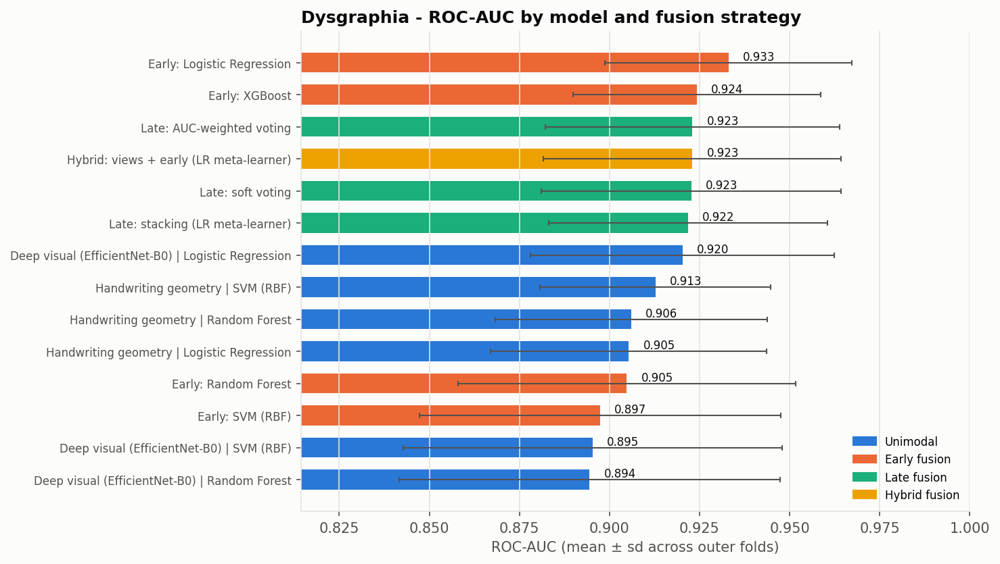

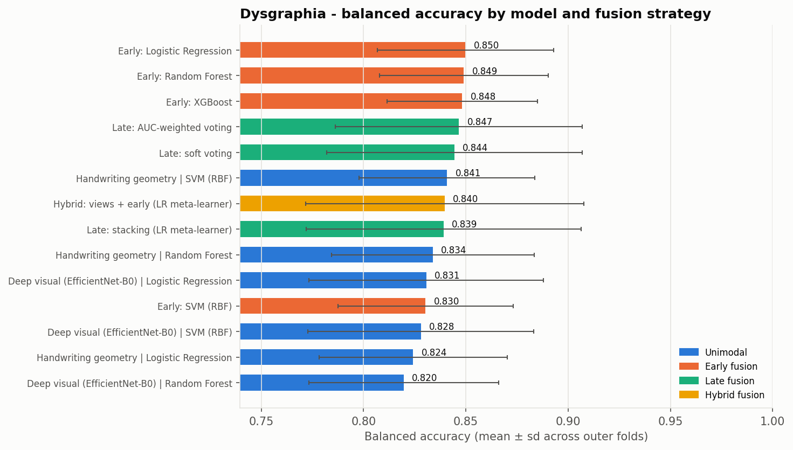

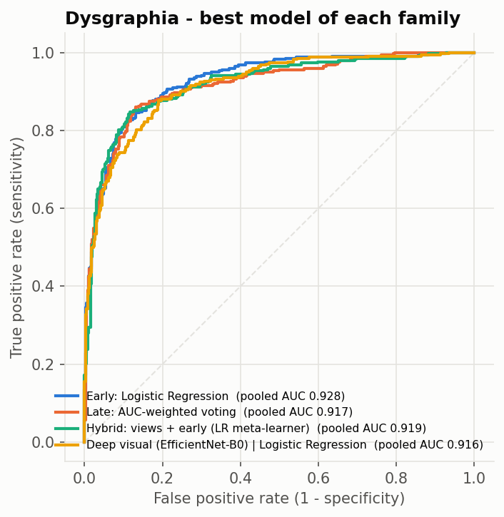
 
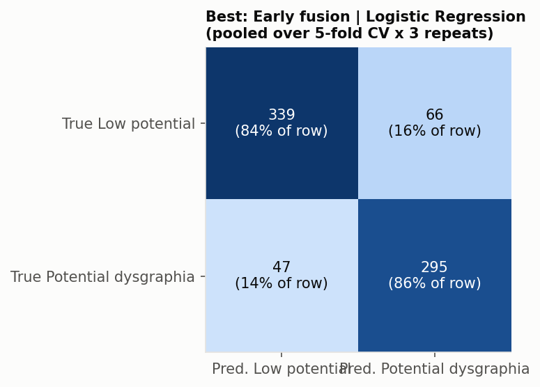

### How late fusion weighted the modalities

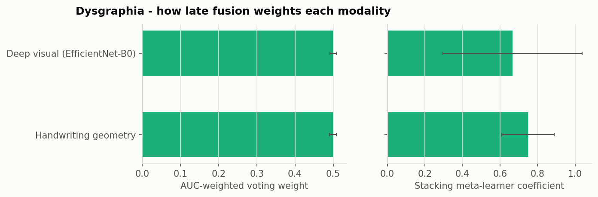

### Explainability

**Which modality matters?** Drop in held-out ROC-AUC of the best early-fusion model when all features of one modality are shuffled together (grouped permutation importance):

| Modality | AUC drop (mean ± sd) |
|---|---|
| Handwriting geometry | 0.041 ± 0.023 |
| Deep visual (EfficientNet-B0) | 0.340 ± 0.093 |

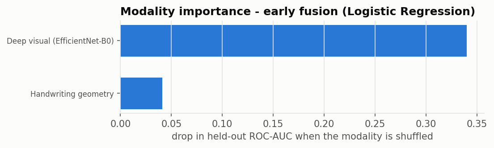

**Most influential handwriting-geometry features** (direction: ↑ = higher value pushes towards dysgraphia):

| Feature | mean \|SHAP\| | Direction |
|---|---|---|
| `letter_height_iqr_ratio` | 0.0856 | ↓ |
| `gap_cv` | 0.0842 | ↓ |
| `sentence_length_in_letter_heights` | 0.0671 | ↓ |
| `contour_convexity_mean` | 0.0517 | ↓ |
| `fragmentation` | 0.0375 | ↑ |
| `contour_tremor` | 0.0366 | ↓ |
| `letter_height_cv` | 0.0329 | ↑ |
| `letters_per_width` | 0.0277 | ↑ |
| `word_gap_count` | 0.0197 | ↓ |
| `topline_residual` | 0.0172 | ↓ |

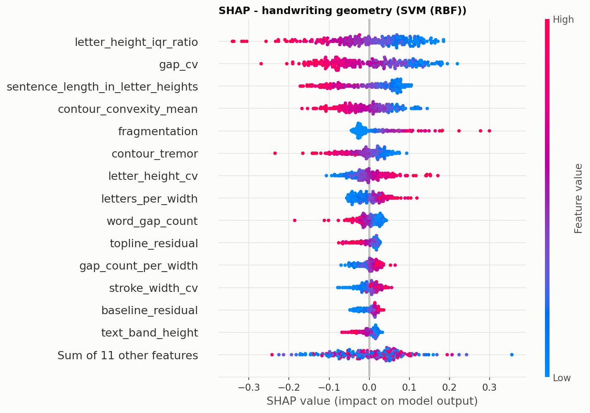

**Where in the handwriting does the CNN look?** Occlusion sensitivity on held-out images:

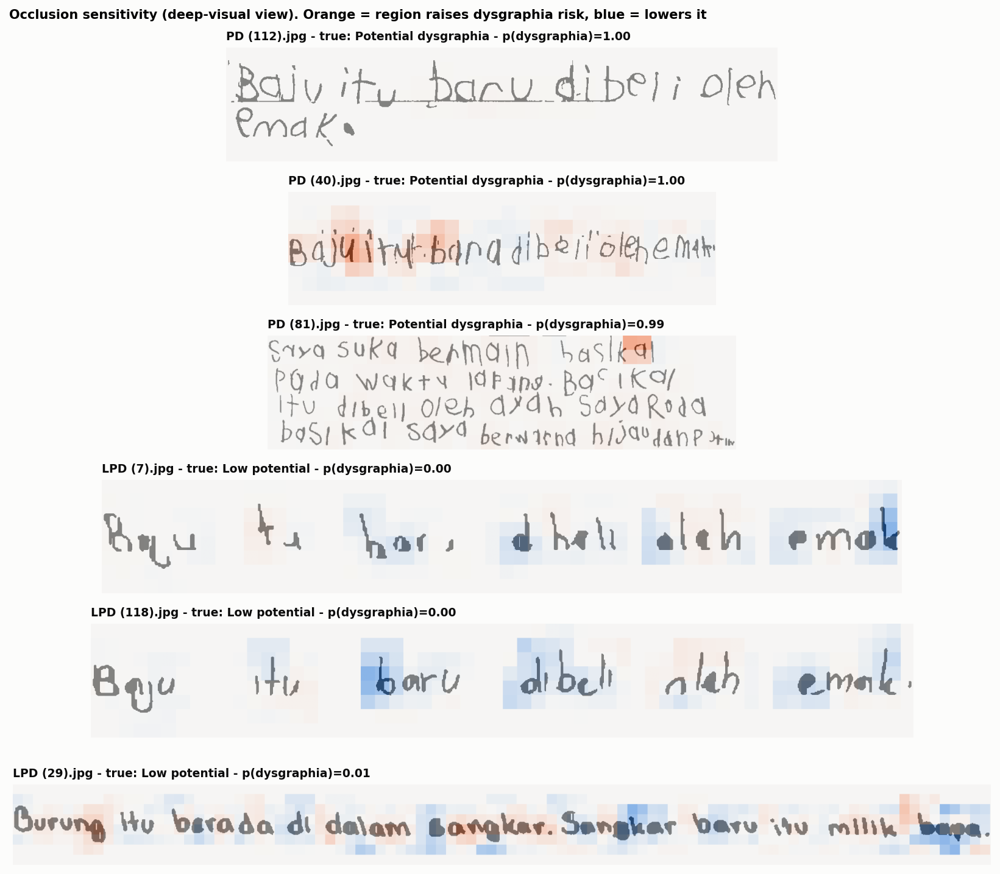

## 3a. Dyscalculia - real data (Castaldi et al. 2024)

**Data:** 37 samples, 15 positive (40.5%). Majority-class accuracy baseline = 0.595.  
**Modalities:** Time perception (4 features), Cognitive profile (3 features)  
**Protocol:** nested CV - 5 outer folds x 10 repeats (50 test folds) x 3 inner folds, stratified.

> Source: Zenodo record 10966052 (CC BY 4.0). `math` (the diagnostic criterion) and `reading` (46% missing, missingness tied to group) were excluded to avoid label leakage. With 37 children these estimates are very uncertain.

### Headline

* **Best model:** `Early fusion | Random Forest`, ROC-AUC **0.766 ± 0.162**, balanced accuracy **0.650 ± 0.161**, sensitivity 0.633, specificity 0.666.
* **Best single modality:** `Unimodal | Time perception | Logistic Regression`, ROC-AUC 0.765 ± 0.174, balanced accuracy 0.679 ± 0.173.
* **Gain from fusion:** +0.000 ROC-AUC over the best single modality.
* Pooled confusion matrix of the best model: TP=95, FN=55, TN=147, FP=73.

### All models (mean ± sd over outer test folds)

| Family | Model | ROC-AUC | Balanced acc. | Sensitivity | Specificity | F1 | Accuracy |
|---|---|---|---|---|---|---|---|
| Early fusion | Random Forest | 0.766 ± 0.162 | 0.650 ± 0.161 | 0.633 ± 0.310 | 0.666 ± 0.290 | 0.576 ± 0.208 | 0.653 ± 0.165 |
| Unimodal | Time perception · Logistic Regression | 0.765 ± 0.174 | 0.679 ± 0.173 | 0.587 ± 0.274 | 0.771 ± 0.229 | 0.595 ± 0.230 | 0.695 ± 0.172 |
| Unimodal | Time perception · Random Forest | 0.762 ± 0.181 | 0.682 ± 0.169 | 0.640 ± 0.292 | 0.724 ± 0.262 | 0.608 ± 0.220 | 0.689 ± 0.171 |
| Early fusion | Logistic Regression | 0.711 ± 0.189 | 0.641 ± 0.150 | 0.547 ± 0.267 | 0.736 ± 0.295 | 0.549 ± 0.212 | 0.661 ± 0.160 |
| Hybrid fusion | views + early (LR meta-learner) | 0.697 ± 0.194 | 0.616 ± 0.165 | 0.540 ± 0.308 | 0.693 ± 0.283 | 0.517 ± 0.242 | 0.631 ± 0.169 |
| Late fusion | AUC-weighted voting | 0.696 ± 0.211 | 0.632 ± 0.210 | 0.593 ± 0.288 | 0.671 ± 0.292 | 0.569 ± 0.241 | 0.640 ± 0.214 |
| Late fusion | stacking (LR meta-learner) | 0.684 ± 0.202 | 0.627 ± 0.179 | 0.580 ± 0.284 | 0.674 ± 0.319 | 0.550 ± 0.231 | 0.635 ± 0.190 |
| Late fusion | soft voting | 0.682 ± 0.207 | 0.630 ± 0.182 | 0.553 ± 0.313 | 0.707 ± 0.302 | 0.536 ± 0.256 | 0.646 ± 0.187 |
| Unimodal | Cognitive profile · Random Forest | 0.534 ± 0.225 | 0.518 ± 0.148 | 0.520 ± 0.388 | 0.517 ± 0.357 | 0.400 ± 0.265 | 0.520 ± 0.153 |
| Unimodal | Cognitive profile · Logistic Regression | 0.474 ± 0.191 | 0.468 ± 0.146 | 0.480 ± 0.388 | 0.455 ± 0.369 | 0.352 ± 0.260 | 0.468 ± 0.158 |
| Early fusion | SVM (RBF) | 0.368 ± 0.180 | 0.470 ± 0.140 | 0.387 ± 0.395 | 0.553 ± 0.412 | 0.292 ± 0.258 | 0.486 ± 0.159 |

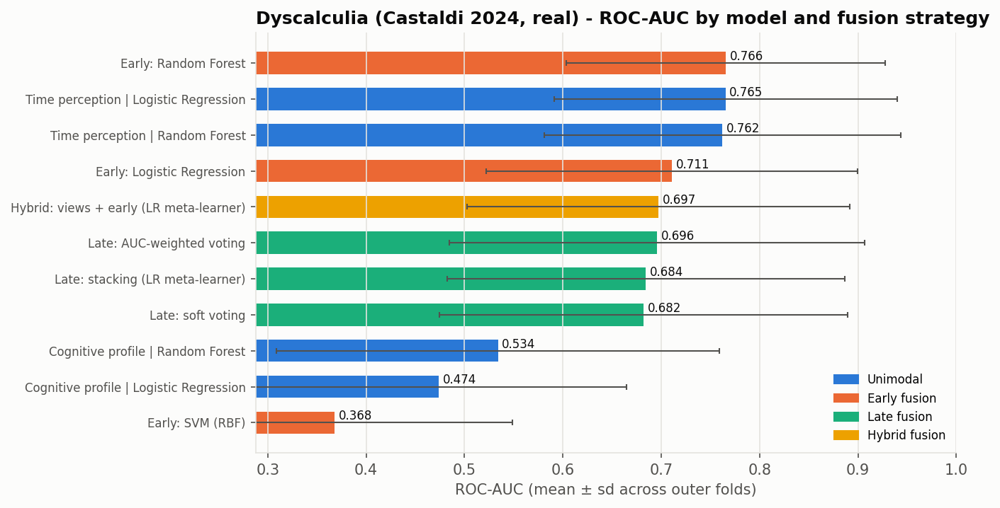

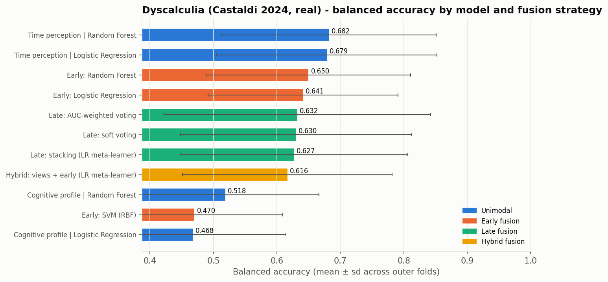

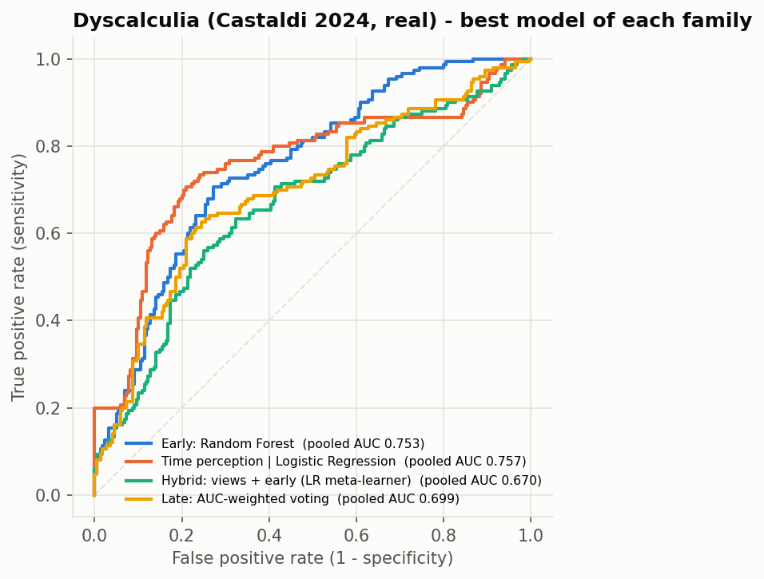
 
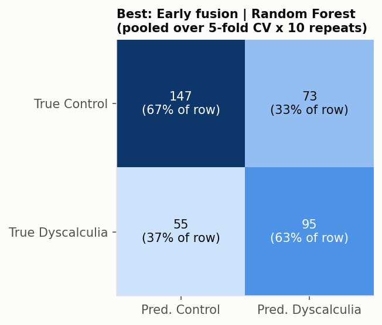

### How late fusion weighted the modalities

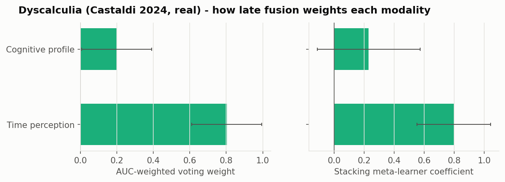

### Explainability

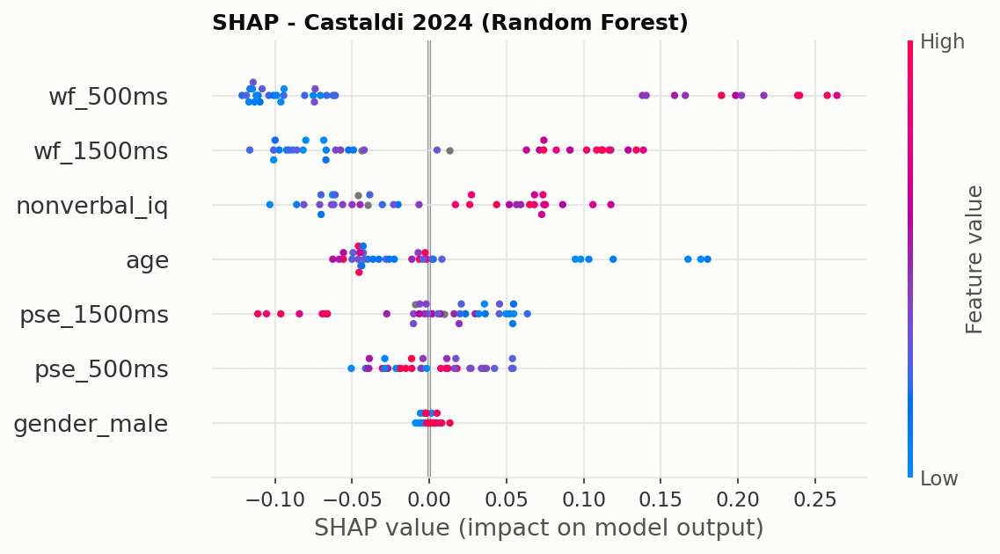

Top features: `wf_500ms`, `wf_1500ms`, `nonverbal_iq`, `age`, `pse_1500ms`, `pse_500ms`, `gender_male`

## 3b. Dyscalculia - SYNTHETIC game telemetry

**Data:** 3000 samples, 401 positive (13.4%). Majority-class accuracy baseline = 0.866.  
**Modalities:** Demographics (2 features), Task accuracy (6 features), Response time (11 features), Number-sense profile (8 features)  
**Protocol:** nested CV - 5 outer folds x 5 inner folds, stratified.

> **Simulated data.** These numbers test the pipeline and the XAI; they say nothing about real children and must not be reported as clinical performance. Generator: `ml/src/dyscalculia_synthetic.py`.

### Headline

* **Best model:** `Early fusion | Random Forest`, ROC-AUC **0.742 ± 0.027**, balanced accuracy **0.682 ± 0.019**, sensitivity 0.611, specificity 0.753.
* **Best single modality:** `Unimodal | Response time | Logistic Regression`, ROC-AUC 0.731 ± 0.008, balanced accuracy 0.671 ± 0.012.
* **Gain from fusion:** +0.011 ROC-AUC over the best single modality.
* Pooled out-of-fold ROC-AUC 95% bootstrap CI: [0.715, 0.768].
* Pooled confusion matrix of the best model: TP=245, FN=156, TN=1958, FP=641.

### All models (mean ± sd over outer test folds)

| Family | Model | ROC-AUC | Balanced acc. | Sensitivity | Specificity | F1 | Accuracy |
|---|---|---|---|---|---|---|---|
| Early fusion | Random Forest | 0.742 ± 0.027 | 0.682 ± 0.019 | 0.611 ± 0.071 | 0.753 ± 0.071 | 0.383 ± 0.030 | 0.734 ± 0.054 |
| Early fusion | Logistic Regression | 0.741 ± 0.020 | 0.688 ± 0.025 | 0.631 ± 0.061 | 0.745 ± 0.019 | 0.384 ± 0.024 | 0.730 ± 0.013 |
| Late fusion | AUC-weighted voting | 0.741 ± 0.020 | 0.673 ± 0.023 | 0.593 ± 0.091 | 0.753 ± 0.063 | 0.372 ± 0.024 | 0.731 ± 0.045 |
| Late fusion | stacking (LR meta-learner) | 0.741 ± 0.016 | 0.680 ± 0.017 | 0.623 ± 0.047 | 0.736 ± 0.049 | 0.375 ± 0.024 | 0.721 ± 0.038 |
| Hybrid fusion | views + early (LR meta-learner) | 0.739 ± 0.016 | 0.683 ± 0.016 | 0.623 ± 0.038 | 0.743 ± 0.043 | 0.380 ± 0.024 | 0.727 ± 0.034 |
| Late fusion | soft voting | 0.737 ± 0.022 | 0.673 ± 0.023 | 0.591 ± 0.074 | 0.755 ± 0.043 | 0.372 ± 0.023 | 0.733 ± 0.030 |
| Unimodal | Response time · Logistic Regression | 0.731 ± 0.008 | 0.671 ± 0.012 | 0.613 ± 0.051 | 0.728 ± 0.046 | 0.364 ± 0.017 | 0.713 ± 0.034 |
| Early fusion | XGBoost | 0.724 ± 0.025 | 0.661 ± 0.035 | 0.586 ± 0.071 | 0.736 ± 0.036 | 0.356 ± 0.040 | 0.716 ± 0.030 |
| Unimodal | Task accuracy · Logistic Regression | 0.711 ± 0.029 | 0.654 ± 0.040 | 0.583 ± 0.043 | 0.725 ± 0.053 | 0.350 ± 0.046 | 0.706 ± 0.048 |
| Unimodal | Response time · XGBoost | 0.709 ± 0.026 | 0.644 ± 0.030 | 0.660 ± 0.122 | 0.627 ± 0.092 | 0.324 ± 0.025 | 0.631 ± 0.066 |
| Unimodal | Task accuracy · XGBoost | 0.689 ± 0.040 | 0.637 ± 0.034 | 0.549 ± 0.056 | 0.726 ± 0.050 | 0.332 ± 0.040 | 0.702 ± 0.043 |
| Unimodal | Number-sense profile · Logistic Regression | 0.655 ± 0.028 | 0.607 ± 0.019 | 0.606 ± 0.061 | 0.609 ± 0.076 | 0.294 ± 0.019 | 0.608 ± 0.059 |
| Unimodal | Number-sense profile · XGBoost | 0.612 ± 0.044 | 0.569 ± 0.034 | 0.618 ± 0.071 | 0.519 ± 0.089 | 0.263 ± 0.027 | 0.533 ± 0.071 |
| Unimodal | Demographics · XGBoost | 0.504 ± 0.015 | 0.481 ± 0.017 | 0.310 ± 0.209 | 0.653 ± 0.205 | 0.160 ± 0.045 | 0.607 ± 0.151 |
| Unimodal | Demographics · Logistic Regression | 0.458 ± 0.028 | 0.493 ± 0.022 | 0.782 ± 0.276 | 0.204 ± 0.294 | 0.222 ± 0.015 | 0.281 ± 0.218 |

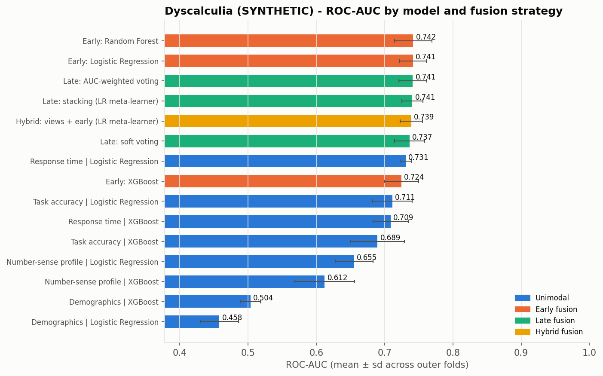

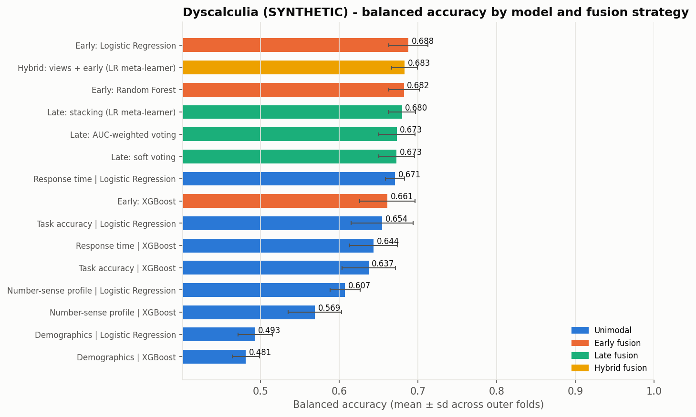

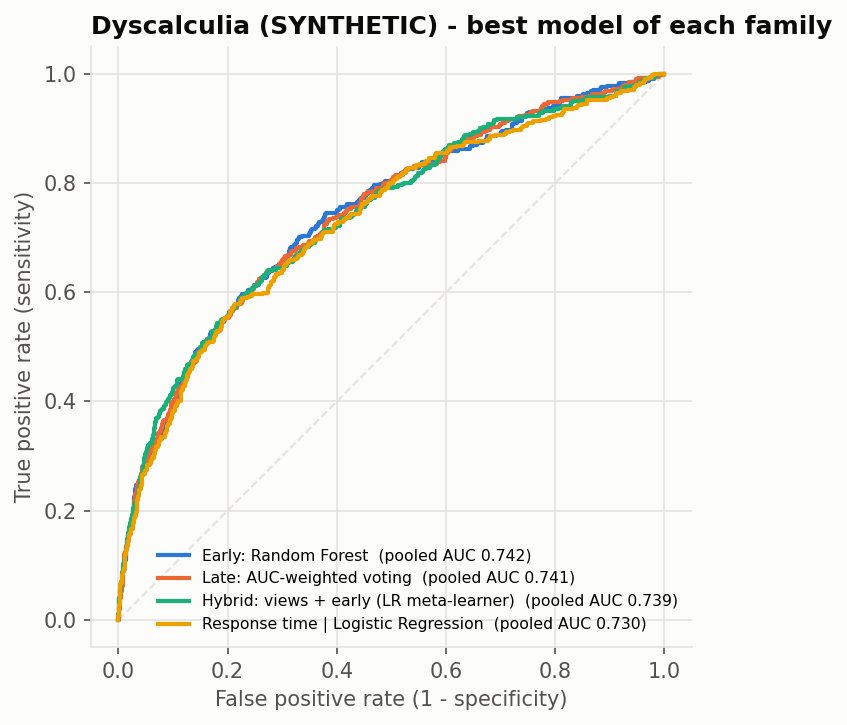
 
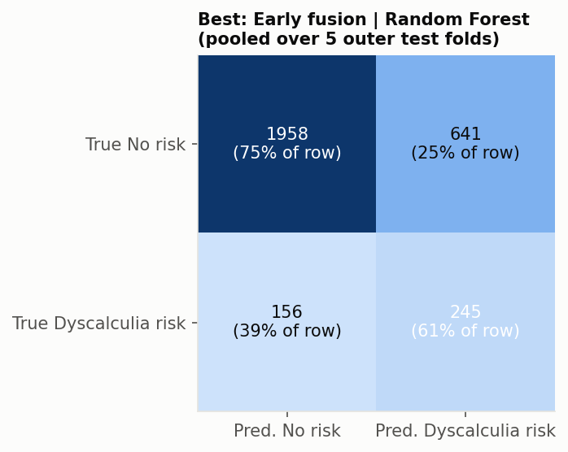

### How late fusion weighted the modalities

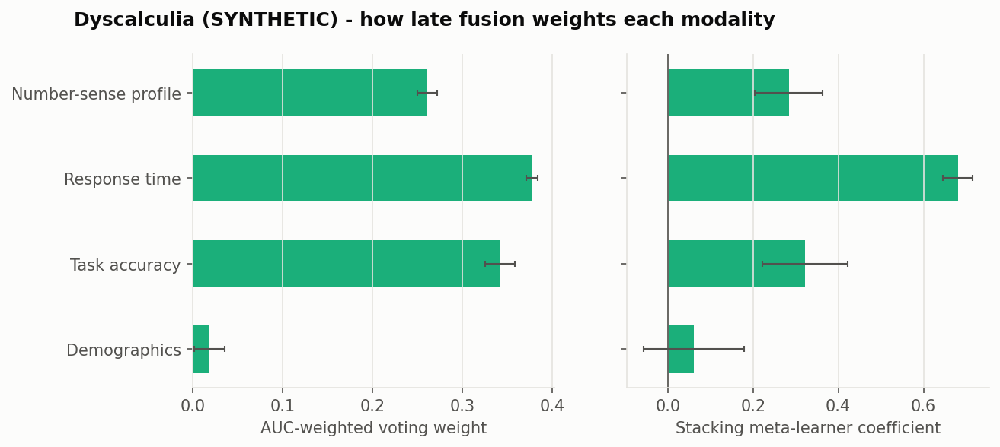

**Best AUC possible given the 5% label noise:** 0.847 (scoring every child by their true simulated status).

### XAI check against the planted effects

Planted deficits (SD): arithmetic/symbolic -1.4, ANS (magnitude, number line) -1.0, speed -0.3, subitizing -0.3, attention -0.2. The explanation should rank arithmetic/sequence features first, number-sense features next and subitizing last.

| Modality | Share of mean abs. SHAP |
|---|---|
| Response time | 56.7% |
| Number-sense profile | 23.5% |
| Task accuracy | 15.4% |
| Demographics | 4.5% |

Top features: `rt_median_arithmetic`, `rt_median_sequence`, `acc_arithmetic`, `rt_median_magnitude`, `numberline_pae`, `numberline_linear_r2`, `age`, `rt_cv_magnitude`

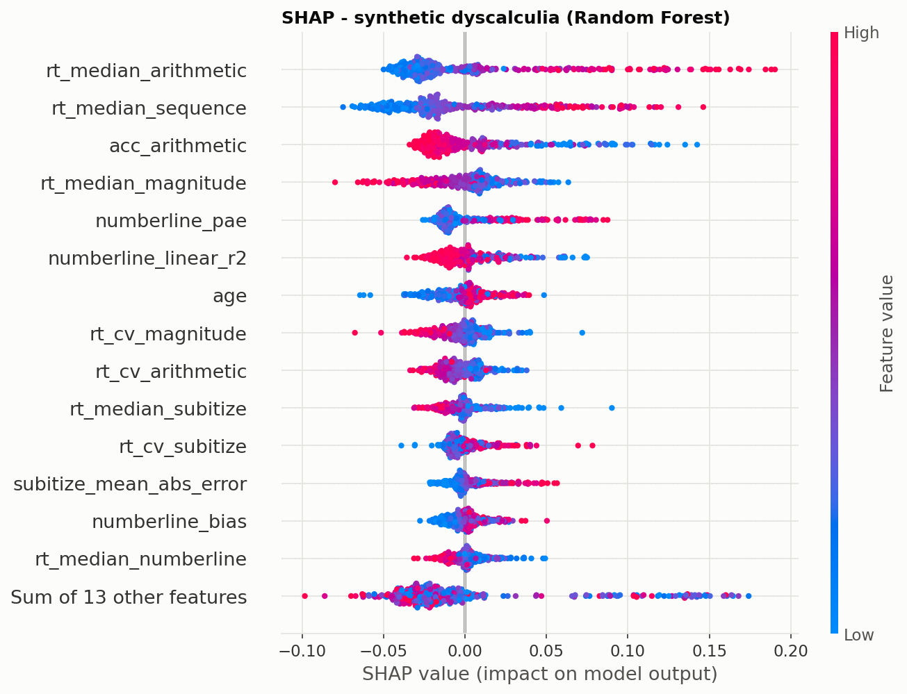

## 4. Main screening model

`ml/src/main_model.py` (`ScreeningSystem`) wraps the best model per disorder, maps probability to the backend's risk levels and combines them like `AssessmentScoringService.synthesizeOverall`. MODERATE_TENDENCY starts at the balanced-accuracy threshold; HIGH_RISK starts where 95% of true negatives score lower.

| Disorder | Model | CV ROC-AUC | Balanced acc. | MODERATE from | HIGH from | Trained on |
|---|---|---|---|---|---|---|
| DYSLEXIA | Hybrid fusion · views + early (LR meta-learner) | 0.863 | 0.769 | p >= 0.52 | p >= 0.81 | real |
| DYSGRAPHIA | Early fusion · Logistic Regression | 0.933 | 0.850 | p >= 0.67 | p >= 0.88 | real |
| DYSCALCULIA | Early fusion · Random Forest | 0.742 | 0.682 | p >= 0.18 | p >= 0.41 | **synthetic** |
